# Jan's Store for DynaFrame Pro

Plugins, live integrations and Magic Mirror modules for DynaFrame Pro digital photo frames. Everything installs straight from the frame's built-in Store.

## Add the store to your frame

1. Open your frame's web interface and go to **Store**.
2. Click **Add Store**.
3. Paste this address:

```
https://raw.githubusercontent.com/Archonw/Jans-DynaframePro-Store/main/catalog.json
```

4. Click **Refresh**. The packs below now appear in the Store and can be installed with one click. Updates show up there as well.

> **Moved:** This store used to live in [Dynaframe-Stuff](https://github.com/Archonw/Dynaframe-Stuff). If you added the old address (`…/Dynaframe-Stuff/main/DynaframPro/Jans-store/catalog.json`), please replace it with the one above. The old address will be removed.

## What's in the store

### Live integrations

Integrations bring their own scene and can show themselves over the running slideshow every few minutes or when something happens. All of them speak German, English and Spanish.

| | Pack | What it does |
|---|---|---|
| 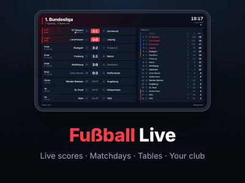 | **Fußball Live** | Live scores, matchdays and tables for the Bundesliga, Champions League, English, Scottish and Spanish leagues and cups, the World Cup and more. Pick your club for its crest and colours. |
| 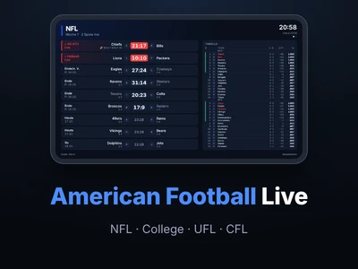 | **American Football Live** | Live scores, weeks and standings for the NFL, College Football (Top 25 and major conferences), UFL and CFL. Can pop up on a touchdown. |
| 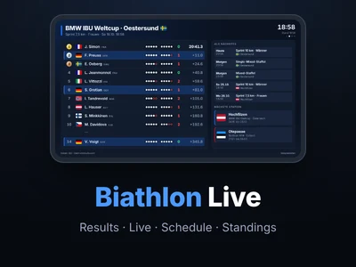 | **Biathlon Live** | Results with shooting, live standings during a race, schedule and World Cup standings from the IBU. Highlights the athletes of your nation. |
| 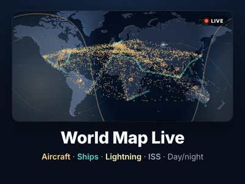 | **World Map Live** | A calm world map with the day-night line and live aircraft, ships, lightning strikes and the ISS. Whole world or a region. |
| 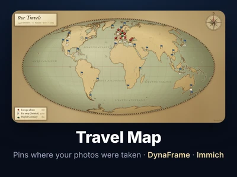 | **Travel Map** | An old-globe style world map with push pins where your photos were taken, from a playlist, the media library, a NAS folder or Immich. Shows a photo at its pin now and then. |
|  | **Foto Cast** | Show the photo you are looking at on your iPhone or Android phone on the frame right away: from the share menu or the frame's phone page. Afterwards your playlist carries on. |
| 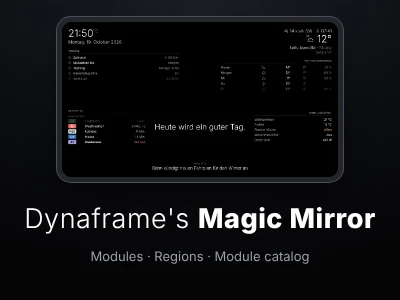 | **Dynaframe's Magic Mirror** | Inspired by MagicMirror²: place modules such as clock, weather, calendar, news or Home Assistant around the screen. More modules below. |

### Plugins

| | Pack | What it does |
|---|---|---|
| 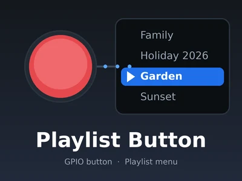 | **Playlist Button** | A GPIO button opens an overlay menu to switch playlists. |
|  | **Web Page Button** | A GPIO button opens one or more web pages full screen over the slideshow (YouTube links play as video) and closes them again. |
|  | **Jellyfin Now Playing** | Shows the cover of what a chosen Jellyfin user is watching or listening to right now. |

### Magic Mirror modules

Add-ons for **Dynaframe's Magic Mirror** (install that first). They appear in the Store and in the Magic Mirror plugin page under "More modules", not as separate plugins.

| | Module | What it shows |
|---|---|---|
|  | **Guest Wi-Fi** | Network name, password and a QR code guests can scan |
| 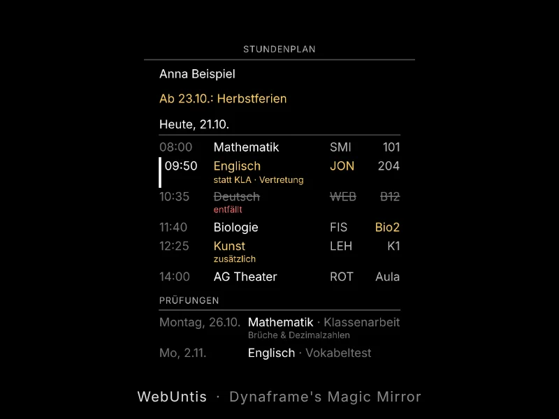 | **WebUntis timetable** | Next school days with substitutions, cancellations, exams and homework |
| 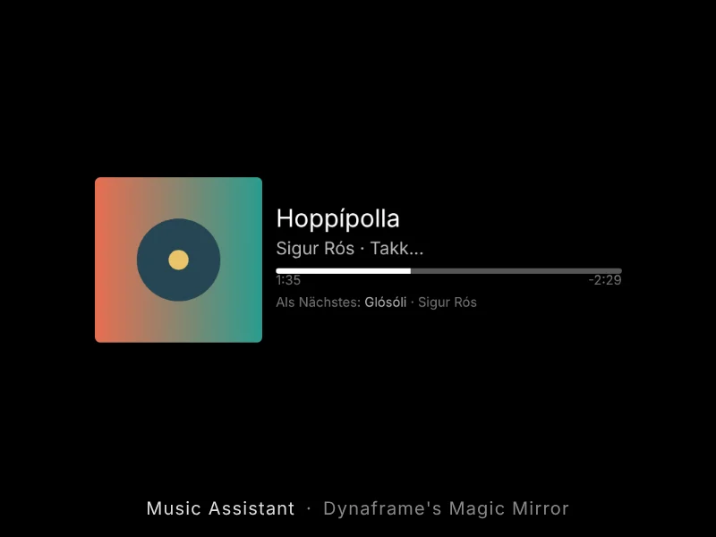 | **Music Assistant** | What's playing on your Music Assistant server |
| 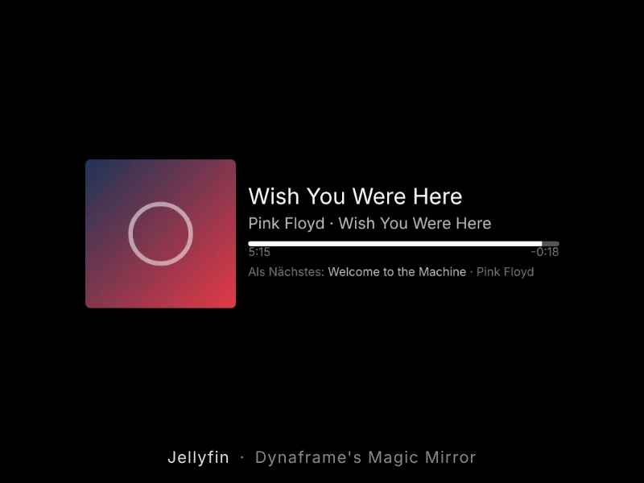 | **Jellyfin now playing** | Music, movie, episode or live TV on your Jellyfin server |
| 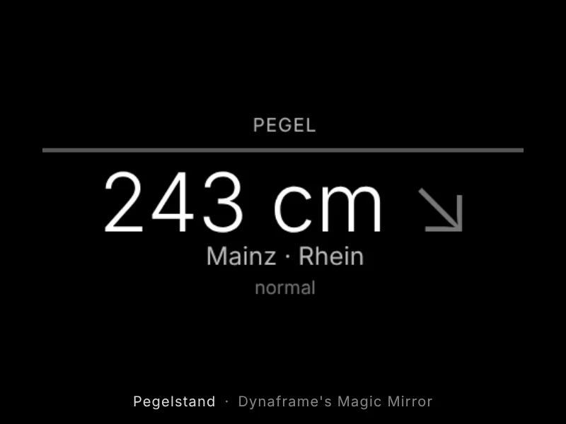 | **River level** | Water level of a gauge on German federal waterways (PEGELONLINE) with trend |

**Build your own module or port one from MagicMirror²:** the guide [MODULES.md](plugin_packs/magic-frame/MODULES.md) is complete on its own, so you can hand it to an AI together with the link to a MagicMirror² module. Working examples are in [module-sources](plugin_packs/magic-frame/module-sources).

## Help and feedback

Problems, questions or ideas? Open an [issue](https://github.com/Archonw/Jans-DynaframePro-Store/issues). Most packs also have a "report a problem" link on their settings page that fills in the pack name for you.

## Please note

These packs were created with AI. I am not a programmer and cannot review the code for security issues myself. Use them at your own discretion.

Not affiliated with DynaFrame. MagicMirror², Home Assistant, Jellyfin, Music Assistant, Immich and WebUntis are projects or products of their respective owners.
