# Jan's Store for DynaFrame Pro

Plugins, live integrations and Magic Mirror modules for DynaFrame Pro digital photo frames. Everything installs straight from the frame's built-in Store.

## Watch the video

<!-- Video player: drag promo/DynaframePro-Promo-EN-small.mp4 into the GitHub editor on this line -->

[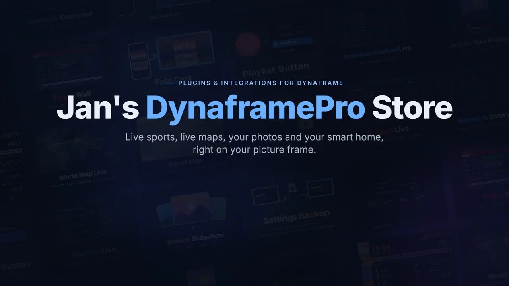](promo/DynaframePro-Promo-EN.mp4)

Full HD download: [English](promo/DynaframePro-Promo-EN.mp4) · [Deutsch](promo/DynaframePro-Promo-DE.mp4)

## Add the store to your frame

1. Open your frame's web interface and go to **Store**.
2. Click **Add Store**.
3. Paste this address:

```
https://raw.githubusercontent.com/Archonw/Jans-DynaframePro-Store/main/catalog.json
```

4. Click **Refresh**. The packs below now appear in the Store and can be installed with one click. Updates show up there as well.

> **Moved:** This store used to live in [Dynaframe-Stuff](https://github.com/Archonw/Dynaframe-Stuff). If you added the old address (`…/Dynaframe-Stuff/main/DynaframPro/Jans-store/catalog.json`), please replace it with the one above. The old address will be removed.

## What's in the store

### Live integrations

Integrations bring their own scene and can show themselves over the running slideshow every few minutes or when something happens. All of them speak German, English and Spanish.

| | Pack | What it does |
|---|---|---|
| 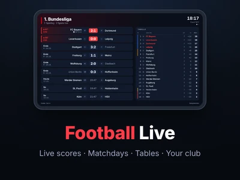 | **Fußball Live** | Live scores, matchdays and tables for the Bundesliga, Champions League, English, Scottish and Spanish leagues and cups, the World Cup and more. Pick your club for its crest and colours. |
| 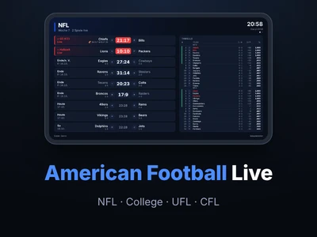 | **American Football Live** | Live scores, weeks and standings for the NFL, College Football (Top 25 and major conferences), UFL and CFL. Can pop up on a touchdown. |
| 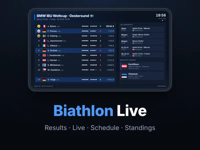 | **Biathlon Live** | Results with shooting, live standings during a race, schedule and World Cup standings from the IBU. Highlights the athletes of your nation. |
| 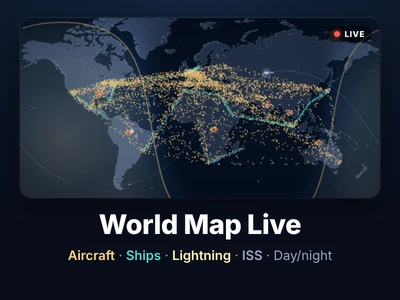 | **World Map Live** | A calm world map with the day-night line and live aircraft, ships, lightning strikes and the ISS. Whole world or a region. |
| 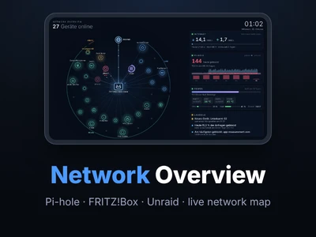 | **Network Overview** | Your home network as a living map: devices online, internet traffic, ads blocked by your Pi-holes and the state of your Unraid server, with a short note on what stands out today. Stays in your home network. |
| 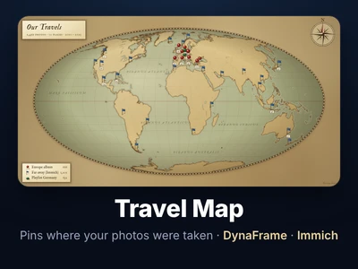 | **Travel Map** | An old-globe style world map with push pins where your photos were taken, from a playlist, the media library, a NAS folder or Immich. Shows a photo at its pin now and then. |
|  | **Foto Cast** | Show the photo or video you are looking at on your iPhone or Android phone on the frame right away: from the share menu (also WhatsApp) or the frame's phone page. Videos play with sound. Phones pair once with a code shown on the frame. Afterwards your playlist carries on. |
|  | **YouTube Cast** | Cast YouTube videos from your phone to the frame like to a TV: tap the cast button in the YouTube app and pick the frame, or send a link. Afterwards your playlist carries on. |
| 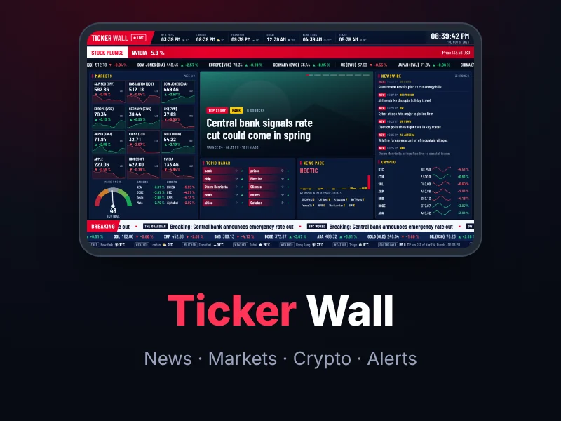 | **Ticker Wall** | Turns the frame into a news-channel and trading-floor wall: news feeds, stock prices, crypto, currencies, world clocks, weather and earthquakes scrolling at once, with a topic radar, breaking-news detection and a market mood gauge. Optional alerts for keywords, price rules or strong earthquakes. Stock prices need a free Finnhub key. |
|  | **Growing Up** | Watch your children (or anyone) grow up: picks the best face per month, quarter or year from your Immich server and plays them as a time-lapse, contact sheet, then and now, or siblings side by side at the same age. Can congratulate on birthdays. |
| 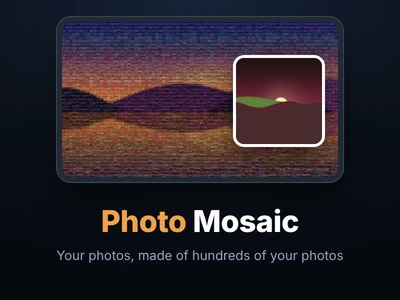 | **Foto Mosaik** | One of your photos rebuilt from hundreds of your own photos as small tiles. The camera glides into a single tile, which turns into the real photo with date and place. Photos from a playlist, the media library or Immich. |
| 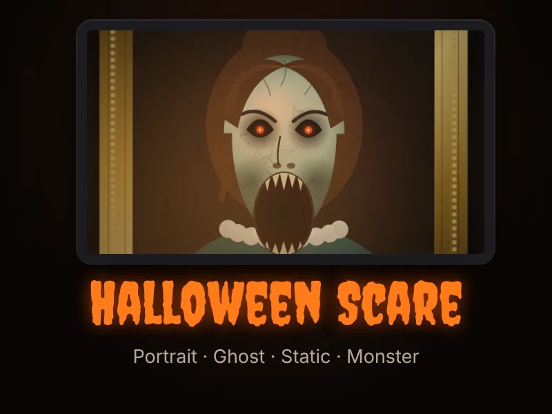 | **Halloween Scare** | A demo of reacting to Home Assistant triggers, with Halloween as the example: when a motion sensor or the doorbell goes off, a jump scare comes over the playlist (haunted portrait, ghost in the current photo, TV static or a monster), with sounds and a gentle version for children. |
| 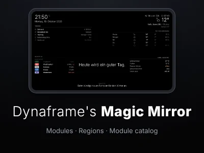 | **Dynaframe's Magic Mirror** | Inspired by MagicMirror²: place modules such as clock, weather, calendar, news or Home Assistant around the screen. More modules below. |

### Plugins

| | Pack | What it does |
|---|---|---|
| 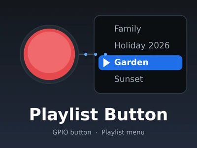 | **Playlist Button** | A GPIO button opens an overlay menu to switch playlists. |
|  | **Web Page Button** | A GPIO button opens one or more web pages full screen over the slideshow (YouTube links play as video) and closes them again. |
|  | **Jellyfin Now Playing** | Shows the cover of what a chosen Jellyfin user is watching or listening to right now. |
|  | **Immich Slideshow** | Photos from your own Immich server in the slideshow, with DynaFrame's own display time and transitions: albums or all photos, narrowed down by stars, favourites, people or a search, random or by date. The photos stay on the server; only the next few are kept on the frame. |
| 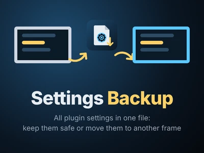 | **Settings Backup** | Saves the settings of all your plugins and scenes to one file and puts them back, on this frame or another one. Missing stores and packs are installed automatically. With a password the file is encrypted and also carries API keys and passwords. Every restore can be undone. |
| 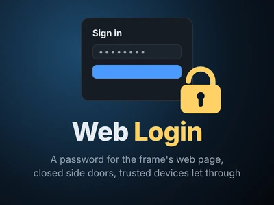 | **Web Login** | Puts a login in front of the frame's web page (password, single sign-on with your own OIDC provider, or both, optionally over HTTPS) and closes the ports that lead past it, except for devices you trust such as Home Assistant or apps with an API key. Never expose the frame to the internet. |

### Magic Mirror modules

Add-ons for **Dynaframe's Magic Mirror** (install that first). They appear in the Store and in the Magic Mirror plugin page under "More modules", not as separate plugins.

| | Module | What it shows |
|---|---|---|
| 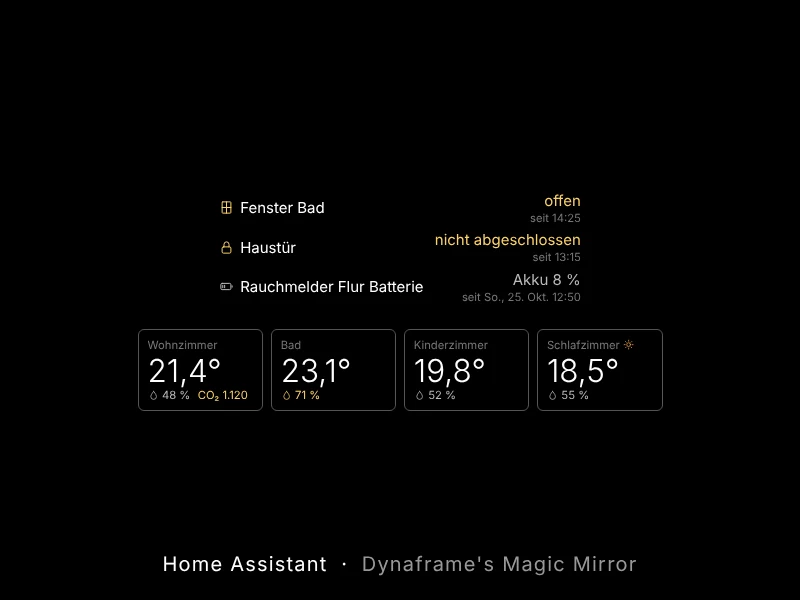 | **Home Assistant** | Values of any entities, house status (open windows, unlocked locks, alarms, low batteries), climate per room, who is home and bin collection. Needs Dynaframe's Magic Mirror 0.7.0 or newer |
| 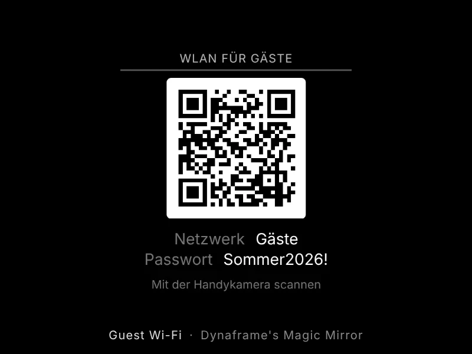 | **Guest Wi-Fi** | Network name, password and a QR code guests can scan |
| 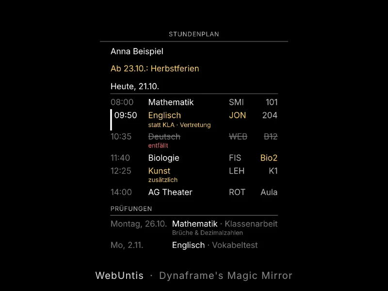 | **WebUntis timetable** | Next school days with substitutions, cancellations, exams and homework |
| 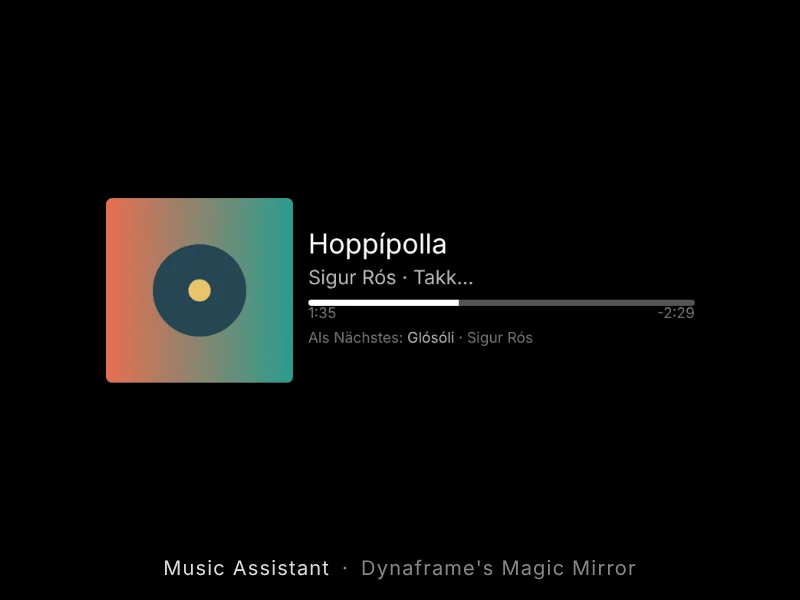 | **Music Assistant** | What's playing on your Music Assistant server |
| 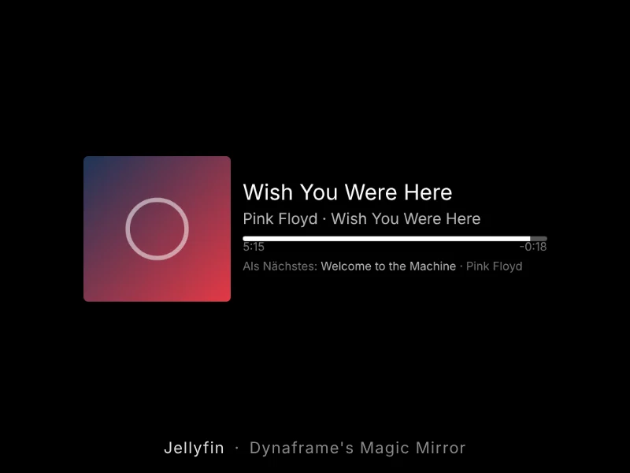 | **Jellyfin now playing** | Music, movie, episode or live TV on your Jellyfin server |
|  | **River level** | Water level of a gauge on German federal waterways (PEGELONLINE) with trend |
| 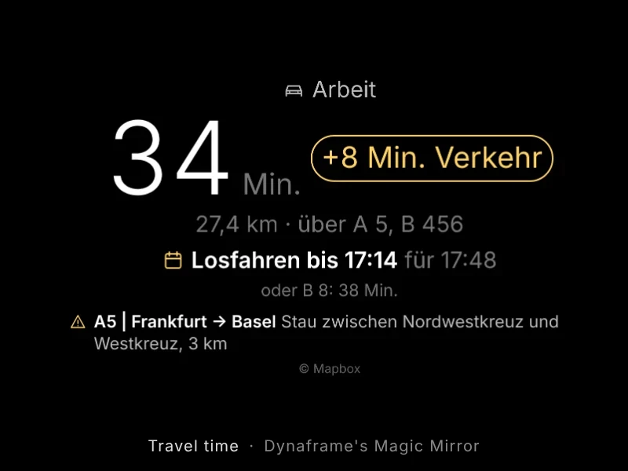 | **Travel time** | How long the drive takes right now, with traffic delay, alternative route and "Leave by" time (own Mapbox or Google key) |
| 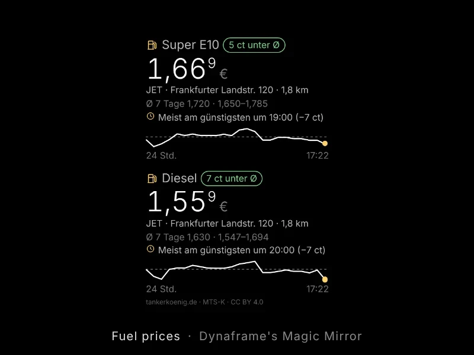 | **Fuel prices** | Cheapest petrol stations near you with real-time prices and whether now is a good time to fill up (Germany, free Tankerkönig key) |
| 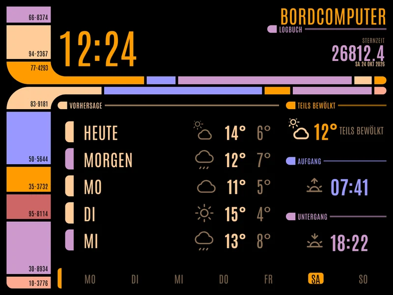 | **Starship console** (skin) | A whole new look for the Magic Mirror: rounded orange and lilac bars like the ship computers of 90s starship series, with clock, stardate and fields you fill yourself |

**Build your own module or port one from MagicMirror²:** the guide [MODULES.md](plugin_packs/magic-frame/MODULES.md) is complete on its own, so you can hand it to an AI together with the link to a MagicMirror² module. Working examples are in [module-sources](plugin_packs/magic-frame/module-sources).

## Help and feedback

Problems, questions or ideas? Open an [issue](https://github.com/Archonw/Jans-DynaframePro-Store/issues). Most packs also have a "report a problem" link on their settings page that fills in the pack name for you.

## Please note

These packs were created with AI. I am not a programmer and cannot review the code for security issues myself. Use them at your own discretion.

Not affiliated with DynaFrame. MagicMirror², Home Assistant, Jellyfin, Music Assistant, Immich, WebUntis, Finnhub, Mapbox, Google and Tankerkönig are projects or products of their respective owners.
